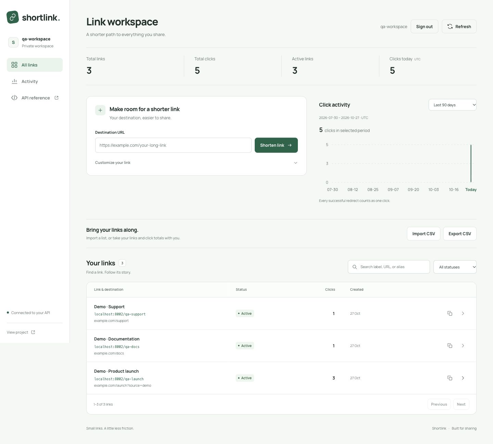

# URL Shortener

[](https://github.com/paidadharshitha/url-shortener-api/actions/workflows/ci.yml)

A FastAPI and SQLite URL shortener with private workspaces, a browser dashboard, and click analytics. Version 2 adds accounts, QR downloads, CSV export, bulk creation, flexible analytics windows, and rate limits while preserving existing short links and click history.

Create links with optional labels, aliases, and expiry; search and edit them; pause or resume redirects; and inspect per-link activity. The dashboard and API run in the same Python application, with no separate frontend build or server.



Preview uses three Demo-labelled links from an isolated local QA database.

## Quick start

Requires Python 3.11 or newer with SQLite 3.35 or newer.

```bash
git clone https://github.com/paidadharshitha/url-shortener-api.git
cd url-shortener-api
python -m venv .venv
source .venv/bin/activate
python -m pip install --upgrade pip
pip install -e '.[dev]'
cp .env.example .env
uvicorn app.main:app --reload --env-file .env
```

On Windows, activate the environment with `.venv\Scripts\Activate.ps1` in PowerShell.

Open the dashboard at <http://localhost:8000>. Interactive API documentation is available at <http://localhost:8000/docs>; the OpenAPI schema is at <http://localhost:8000/openapi.json>.

Create an account in the dashboard, then sign in to your private workspace. Authentication is required for link creation, management, statistics, and downloads. Short-link redirects remain public. Each account can access only its own links; aliases are unique across all accounts.

### Configuration

| Variable | Default | Purpose |
| --- | --- | --- |
| `DATABASE_PATH` | `data/links.sqlite3` | SQLite database file. Keep this file on persistent storage. |
| `BASE_URL` | `http://localhost:8000` | Public origin used in short URLs, QR codes, and browser-origin checks. |
| `SESSION_DAYS` | `7` | Session lifetime, from 1 to 30 days. |
| `RATE_LIMIT_ENABLED` | `true` | Enable SQLite-backed request quotas; accepts `true` or `false`. |

Configuration is read when the application starts. Export environment variables directly, or use Uvicorn's `--env-file .env` option as above. The application does not load `.env` files itself. Set `BASE_URL` to the public HTTPS origin when deploying behind a reverse proxy. The dashboard expects the application at the origin root.

To use another port, pass `--port` to Uvicorn and set `BASE_URL` to the matching address so copied links point to the running service.

For a local preview on port 8001:

```bash
BASE_URL=http://localhost:8001 uvicorn app.main:app --reload --env-file .env --port 8001
```

Open <http://localhost:8001>. The command-level `BASE_URL` overrides the value in `.env` for this run.

## Endpoints

| Method | Path | Success | Authentication | Description |
| --- | --- | --- | --- | --- |
| `GET` | `/` | `200` | Public | Open the dashboard. |
| `POST` | `/auth/register` | `201` | Public | Create an account and session. |
| `POST` | `/auth/login` | `200` | Public | Sign in. |
| `GET` | `/auth/me` | `200` | Required | Read the current user and CSRF token. |
| `POST` | `/auth/logout` | `204` | Required | Revoke the current session. |
| `POST` | `/links` | `201` | Required | Create a short link. |
| `GET` | `/links` | `200` | Required | Search, filter, and paginate your links. |
| `PATCH` | `/links/{code}` | `200` | Owner | Edit or pause/resume a link. |
| `GET` | `/links/overview` | `200` | Required | Read your workspace totals and daily activity. |
| `GET` | `/links/{code}/stats` | `200` | Owner | Read metadata and click statistics. |
| `GET` | `/links/{code}/qr.svg` | `200` | Owner | Download a QR code for the short URL. |
| `GET` | `/links/export.csv` | `200` | Required | Export your filtered links. |
| `POST` | `/links/bulk` | `200` | Required | Create links from a CSV file, with per-row results. |
| `GET` | `/{code}` | `302` | Public | Redirect and record one click. |

### Create an account and authenticate

Usernames are normalized to lowercase, contain 3–32 ASCII letters, digits, underscores, or hyphens, and start with a letter or digit. Passwords contain 10–128 characters and cannot be entirely whitespace. Choose your own credentials; the following values are for a local demonstration only.

```bash
SESSION=$(curl --fail-with-body -sS -X POST http://localhost:8000/auth/register \
  -H 'Content-Type: application/json' \
  -d '{"username":"demo-user","password":"change-this-demo-password"}')
TOKEN=$(printf '%s' "$SESSION" | python -c 'import json,sys; print(json.load(sys.stdin)["access_token"])')
```

The response includes `user`, `access_token`, `token_type`, `csrf_token`, and `expires_at`. Use the bearer token in the remaining examples. To sign in to an existing account, call `/auth/login` with the same body and replace `TOKEN` with the returned `access_token`.

```bash
curl http://localhost:8000/auth/me -H "Authorization: Bearer $TOKEN"
```

Swagger's **Authorize** button accepts the bearer token. The browser dashboard uses an `HttpOnly`, `SameSite=Lax` session cookie instead. Cookies are `Secure` when `BASE_URL` uses HTTPS. Cookie-authenticated mutations also require the `X-CSRF-Token` header returned by registration, login, or `/auth/me`; the dashboard sends it automatically. Browser origins must match `BASE_URL`. Bearer API calls do not need a separate CSRF token.

After trying the examples below, end the current session:

```bash
curl -i -X POST http://localhost:8000/auth/logout -H "Authorization: Bearer $TOKEN"
```

Logging out revokes that token; other sessions remain independent. Sessions also expire after `SESSION_DAYS`.

### Create a link

Only `url` is required. Omit `alias` to generate a short code, and omit `expires_at` for a link that does not expire.

```bash
curl -i -X POST http://localhost:8000/links \
  -H "Authorization: Bearer $TOKEN" \
  -H 'Content-Type: application/json' \
  -d '{"url":"https://example.com/articles/introducing-our-product?source=share"}'
```

To include a title, custom alias, and expiry:

```bash
curl -i -X POST http://localhost:8000/links \
  -H "Authorization: Bearer $TOKEN" \
  -H 'Content-Type: application/json' \
  -d '{
    "url": "https://example.com/products/launch",
    "title": "Product launch",
    "alias": "launch",
    "expires_at": "2099-12-31T23:59:59Z"
  }'
```

Example `201 Created` response; the creation timestamp reflects the request time:

```json
{
  "code": "launch",
  "url": "https://example.com/products/launch",
  "short_url": "http://localhost:8000/launch",
  "title": "Product launch",
  "created_at": "2026-10-27T10:30:00Z",
  "expires_at": "2099-12-31T23:59:59Z",
  "total_clicks": 0,
  "last_clicked_at": null,
  "is_active": true,
  "is_expired": false,
  "status": "active"
}
```

Timestamps use ISO 8601 and are normalized to UTC. `expires_at` is `null` when omitted.

Validation rules:

- Destinations must be valid absolute HTTP or HTTPS URLs of at most 2,083 characters, without embedded credentials or control characters. URLs are normalized by the validator, for example by adding a trailing slash to a bare origin.
- Titles are trimmed and may contain up to 120 characters. Blank titles are stored as `null`.
- Aliases contain 3–64 ASCII letters, digits, underscores, or hyphens, and must start with a letter or digit.
- Aliases are case sensitive: `Launch` and `launch` are different codes. Application route names are reserved, ignoring case.
- An alias already in use returns `409 Conflict`, including when its existing link has expired.
- Expiry must include a timezone and be in the future. A link expires when the current time reaches its expiry timestamp.
- Unrecognized request fields are rejected to catch misspellings.

### Search and filter links

```bash
curl --get http://localhost:8000/links \
  -H "Authorization: Bearer $TOKEN" \
  --data-urlencode 'q=launch' \
  --data-urlencode 'status=active' \
  --data-urlencode 'limit=20' \
  --data-urlencode 'offset=0'
```

The response contains `items`, `total`, `limit`, and `offset`. Each item has the same fields as the creation response. `total` is the number of matching links before pagination. Supported status values are `all`, `active`, `paused`, and `expired`; the default is `all`.

Search matches a literal, case-insensitive substring of the title, destination URL, or code. Omit `q` to list all matching links; queries may contain up to 200 characters. `limit` defaults to 20 and accepts 1–100; `offset` defaults to 0 and must be nonnegative. Results are ordered by creation time descending, with code ascending as a tie-breaker.

### Edit, pause, and resume

Update a destination or title without changing the short code:

```bash
curl -X PATCH http://localhost:8000/links/launch \
  -H "Authorization: Bearer $TOKEN" \
  -H 'Content-Type: application/json' \
  -d '{"url":"https://example.com/products/new-launch","title":"Updated launch"}'
```

Pause a link, then resume it:

```bash
curl -X PATCH http://localhost:8000/links/launch \
  -H "Authorization: Bearer $TOKEN" \
  -H 'Content-Type: application/json' \
  -d '{"is_active":false}'

curl -X PATCH http://localhost:8000/links/launch \
  -H "Authorization: Bearer $TOKEN" \
  -H 'Content-Type: application/json' \
  -d '{"is_active":true}'
```

Supported update fields are `url`, `title`, `expires_at`, and `is_active`. Omitted fields remain unchanged. Set `title` or `expires_at` to `null` to clear it; `url` and `is_active` cannot be `null`. An empty update is rejected with `422`.

Pausing preserves the link and its statistics. Resuming retains the expiry, so an expired link also needs a future expiry or `"expires_at": null` before it can redirect. Aliases cannot be changed, and there is no destructive delete endpoint.

The update response has the same fields as the creation response. Displayed status is `paused` whenever `is_active` is false, even if the expiry has also passed; `is_expired` independently records whether the expiry has passed.

### Follow a link

Inspect the redirect without following it:

```bash
curl -i http://localhost:8000/launch
```

The response has status `302`, a `Location` header pointing to the destination, and `Cache-Control: no-store`. Add `-L` to follow the redirect.

Every successful redirect request records one click, including repeat visits and retries. Unknown, paused, and expired links do not record clicks. Click totals count requests, not unique people; bots and link preview fetches may count too.

### Read statistics

```bash
curl http://localhost:8000/links/launch/stats -H "Authorization: Bearer $TOKEN"
```

Example response for the original link after one redirect:

```json
{
  "code": "launch",
  "url": "https://example.com/products/launch",
  "short_url": "http://localhost:8000/launch",
  "title": "Product launch",
  "created_at": "2026-10-27T10:30:00Z",
  "expires_at": "2099-12-31T23:59:59Z",
  "total_clicks": 1,
  "last_clicked_at": "2026-10-27T10:31:00Z",
  "is_active": true,
  "is_expired": false,
  "status": "active",
  "start_date": "2026-10-21",
  "end_date": "2026-10-27",
  "period_clicks": 1,
  "daily_clicks": [
    {"date": "2026-10-21", "clicks": 0},
    {"date": "2026-10-22", "clicks": 0},
    {"date": "2026-10-23", "clicks": 0},
    {"date": "2026-10-24", "clicks": 0},
    {"date": "2026-10-25", "clicks": 0},
    {"date": "2026-10-26", "clicks": 0},
    {"date": "2026-10-27", "clicks": 1}
  ]
}
```

The response fields are:

| Field | Meaning |
| --- | --- |
| `code`, `url`, `short_url` | Short code, destination URL, and complete sharing URL. |
| `title` | Optional human-readable title, or `null`. |
| `created_at`, `expires_at` | Creation time and optional expiry time. |
| `total_clicks` | Number of successful redirect requests. |
| `last_clicked_at` | Most recent successful redirect time, or `null` before the first click. |
| `is_active` | Whether redirects are enabled; expiry still applies. |
| `is_expired` | Whether the link has reached its expiry time. |
| `status` | `active`, `paused`, or `expired`; paused takes precedence. |
| `daily_clicks` | Selected UTC dates in ascending order, each with `date` and `clicks`. |
| `start_date`, `end_date` | Inclusive bounds of the resolved analytics window. |
| `period_clicks` | Successful redirects within that window; distinct from the lifetime total. |

Reading statistics does not count as a click. Paused and expired links remain available through the statistics endpoint.

### Workspace overview

```bash
curl http://localhost:8000/links/overview -H "Authorization: Bearer $TOKEN"
```

The response contains `total_links`, `active_links`, `paused_links`, `expired_links`, `total_clicks`, `clicks_today`, `daily_clicks`, `start_date`, `end_date`, and `period_clicks`. All totals are scoped to the signed-in account. Status counts describe the current state; `total_clicks` is the lifetime total. `clicks_today` always means the current UTC day, even when inspecting an earlier range.

Both overview and per-link statistics accept `days=7`, `days=30`, or `days=90`; the default is 7, including today. For a custom range, supply both `start_date` and `end_date` as `YYYY-MM-DD`. Bounds are inclusive, the range can contain at most 366 days, and future dates are rejected. Explicit dates select the window instead of the preset. Every date appears, including zero-click days.

```bash
curl --get http://localhost:8000/links/overview \
  -H "Authorization: Bearer $TOKEN" --data-urlencode 'days=30'

curl --get http://localhost:8000/links/launch/stats \
  -H "Authorization: Bearer $TOKEN" \
  --data-urlencode 'start_date=2026-10-01' \
  --data-urlencode 'end_date=2026-10-27'
```

### Download a QR code

```bash
curl --fail-with-body http://localhost:8000/links/launch/qr.svg \
  -H "Authorization: Bearer $TOKEN" --output launch.svg
```

QR codes are generated locally as SVG files and encode the complete short URL. Downloading a QR code does not count a click; visiting its encoded link does. A phone needs to reach the configured `BASE_URL`, so a QR code using `localhost` is for testing on the server's own machine. Another user's code returns `404`.

### Export links to CSV

```bash
curl --fail-with-body --get http://localhost:8000/links/export.csv \
  -H "Authorization: Bearer $TOKEN" \
  --data-urlencode 'status=active' --data-urlencode 'q=launch' \
  --output links.csv
```

Export uses the same `q` and `status` filters as the list endpoint and includes all matching owned links, up to 10,000. Larger results return `413`; narrow the filters instead of receiving a silently truncated export. Columns are `code`, `title`, `url`, `short_url`, `status`, `total_clicks`, `last_clicked_at`, `created_at`, and `expires_at`.

The UTF-8 CSV includes a byte-order mark for spreadsheet compatibility. Potential formula cells are prefixed with an apostrophe to prevent spreadsheet execution. Exporting does not record clicks. The export is a report; its columns differ from the import template below.

### Bulk shortening from CSV

Create `links-to-import.csv` with a required `url` column and optional `title`, `alias`, and `expires_at` columns:

```csv
url,title,alias,expires_at
https://example.com/products/spring,Spring launch,spring-launch,
https://example.com/articles/guide,Product guide,,2099-12-31T23:59:59Z
```

```bash
curl --fail-with-body -X POST http://localhost:8000/links/bulk \
  -H "Authorization: Bearer $TOKEN" -H 'Content-Type: text/csv' \
  --data-binary @links-to-import.csv
```

Send the raw CSV body, not multipart form data. Files must use UTF-8, be at most 512 KiB, and contain no more than 100 nonblank data rows. Headers are case-insensitive and must be unique. Unknown columns, malformed CSV, or mismatched field counts reject the whole file before any links are written.

After structural validation, each row is independent. A `200` response contains `created_count`, `error_count`, and `results`; each result names the CSV line in `row`, its `status`, and either the created `link` or an `error`. Valid rows return row status `201`; invalid URLs or expiry return `422`, duplicate aliases `409`, and exhausted generated codes `503`. Successful rows stay saved when other rows fail. Retry only failed rows to avoid creating duplicate links with generated aliases.

### Rate limits

Quotas use fixed 60-second windows and are stored in SQLite, so application workers sharing the database enforce the same allowance.

| Operation | Limit | Identity |
| --- | --- | --- |
| Registration | 5 requests/minute | Client IP |
| Login | 10 requests/minute | Client IP |
| Link list, create, edit, statistics, overview, export, QR download | 240 requests/minute, shared | Account |
| Single and bulk link creation | 120 attempted links/minute, shared | Account |
| Bulk imports | 5 requests/minute, including invalid uploads | Account |
| Redirect requests | 120 requests/minute | Client IP |

Bulk requests use their own allowance rather than the management allowance. After CSV structure validation, each data row also consumes the shared creation allowance. All CSV rows consume creation capacity before writes, including rows that later fail validation. Requests over a quota receive `429` and a `Retry-After` header with the remaining seconds. Do not immediately retry them. `RATE_LIMIT_ENABLED=false` is useful for isolated tests; leave the default enabled for shared use.

The application does not read arbitrary `X-Forwarded-For` headers. If using a reverse proxy, configure Uvicorn's trusted proxy addresses so client IP quotas identify visitors correctly.

### Errors

Errors use JSON responses with a `detail` field. Validation errors identify the invalid request field.

| Status | Meaning |
| --- | --- |
| `400 Bad Request` | Malformed CSV structure or encoding. |
| `401 Unauthorized` | Missing, invalid, revoked, or expired session. |
| `403 Forbidden` | Invalid browser origin or cookie CSRF token. |
| `404 Not Found` | The code does not exist or is not owned by the signed-in account. |
| `409 Conflict` | The requested alias is already taken. |
| `410 Gone` | The link is paused or has expired; applies to redirects. |
| `413 Content Too Large` | CSV import or export exceeds its limit. |
| `415 Unsupported Media Type` | Bulk import requires `Content-Type: text/csv`. |
| `422 Unprocessable Entity` | Invalid fields, query parameters, expiry, date range, or empty update. |
| `429 Too Many Requests` | A request quota was reached; respect `Retry-After`. |
| `503 Service Unavailable` | A generated code could not be allocated after repeated collisions; retry the request. |

## Tests and code checks

Install the development dependencies from the quick start, then run:

```bash
pytest
pytest --cov=app --cov-report=term-missing
ruff check .
ruff format --check .
```

Tests use isolated temporary databases and FastAPI's [TestClient testing pattern](https://fastapi.tiangolo.com/tutorial/testing/). They exercise validation, aliases, redirects, expiry, atomic click counting, workspace isolation, sessions, CSRF, quotas, CSV transfers, QR output, date ranges, migrations, and database persistence. GitHub Actions runs the checks on Python 3.11, 3.12, and 3.13.

The verified suite passes **251 tests** with **95% coverage**, including branch measurement. Ruff lint and formatting checks pass.

A separate CI job builds the Docker image and checks dashboard assets, authenticated creation, pause/resume, public redirects, date-range analytics, QR/CSV downloads, partial CSV import, and persistence after a container restart.

## Run with Docker

```bash
docker build -t url-shortener .
docker run --rm --name url-shortener \
  -p 127.0.0.1:8000:8000 \
  -e BASE_URL=http://localhost:8000 \
  -v url-shortener-data:/data \
  url-shortener
```

The container runs as an unprivileged user and stores the database in `/data/links.sqlite3`. The named volume preserves links after the container stops. If using a host bind mount instead, ensure UID `10001` can write to that directory.

### Upgrading an existing database

Back up the database, then keep the existing `DATABASE_PATH` or Docker data volume. Startup migrations add ownership and supporting tables without deleting existing links, lifetime totals, timestamps, or daily history.

Links created before accounts existed remain **unowned**. Their public redirects continue to work according to their existing pause and expiry settings. They do not appear in any new account, and registration never silently claims them.

After creating the intended owner's account, a local operator can assign all currently unowned links explicitly:

```bash
python -m app.admin claim-legacy demo-user
```

Run this command against the same database as the server. The CLI reads environment variables directly, so export `DATABASE_PATH` when using a nondefault path; it does not load `.env` itself. For the example Docker container:

```bash
docker exec url-shortener python -m app.admin claim-legacy demo-user
```

The command leaves links already owned by another account unchanged. It also preserves all link metadata and click history. If upgrading from a version without daily analytics, historical lifetime clicks are not assigned to invented dates; only previously recorded daily activity is available.

## Design and scope

The application separates request validation, HTTP routing, and persistence:

```text
app/
├── main.py             # Application factory, routes, and HTTP error mapping
├── schemas.py          # Request validation and response schemas
├── service.py          # Link management, code generation, and redirect policy
├── repository.py       # SQLite schema, migration, queries, and atomic click updates
├── domain.py           # Link model and domain errors
├── config.py           # Environment configuration
├── auth.py             # Password hashing, sessions, cookies, and workspace authorization
├── rate_limit.py       # Atomic SQLite quotas shared across workers
├── transfers.py        # CSV import/export and QR downloads
├── admin.py            # Explicit local ownership migration
└── static/             # Dashboard HTML, CSS, and JavaScript
tests/
├── conftest.py         # Temporary database, test client, and controlled clock
├── test_links.py       # Redirects, statistics, expiry, persistence, and concurrency
├── test_management.py  # Search, filtering, pagination, editing, and pause/resume
├── test_analytics.py   # Daily click activity and workspace overview
├── test_migrations.py  # Legacy database upgrades and preserved data
├── test_dashboard.py   # Dashboard and static assets
├── test_ranges_ownership.py # Private data and inclusive UTC windows
├── test_auth_units.py   # Account, session, and CSRF checks
├── test_rate_limits.py  # Quota boundaries and concurrency
├── test_transfers.py   # CSV and QR behavior
├── test_validation.py  # Request validation and alias rules
└── test_config.py      # Configuration behavior
```

Generated codes use eight cryptographically random letters and digits; collisions are retried. SQLite keeps setup simple, and database constraints enforce code uniqueness. [Write-ahead logging](https://www.sqlite.org/wal.html) allows reads alongside writes. Successful redirects update lifetime and daily counters together, so concurrent requests do not overwrite each other's counts. Expiry and pause state are checked when a redirect is requested; no background cleanup job is needed.

SQLite is a good fit for a service on one machine with persistent storage. For a deployment spread across multiple machines or sustained high write traffic, adapt persistence to a shared database such as Postgres.

Passwords use a unique 16-byte random salt and scrypt with `N=16384`, `r=8`, `p=5`, one of the configurations listed in the [OWASP password-storage guidance](https://cheatsheetseries.owasp.org/cheatsheets/Password_Storage_Cheat_Sheet.html#scrypt). The database stores password hashes and SHA-256 session-token digests rather than plaintext passwords or usable session tokens. Logout revokes the current session.

For public deployment, serve over HTTPS, set the correct `BASE_URL`, keep request limits enabled, and maintain database backups. This project does not include password recovery, email verification, or MFA. URL validation checks syntax, not whether a destination is reachable or trustworthy; a public shortener still needs an abuse-reporting and moderation policy.
