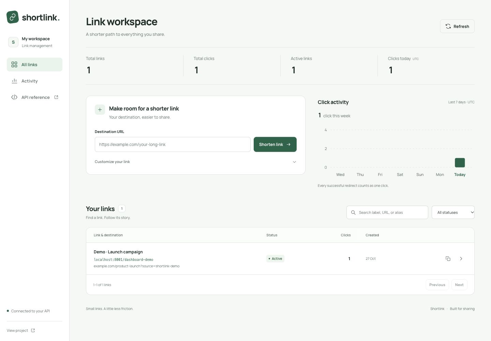

# URL Shortener

[](https://github.com/paidadharshitha/url-shortener-api/actions/workflows/ci.yml)

A FastAPI and SQLite URL shortener with a browser dashboard, link management, and click analytics. Version 1.1 adds search, filters, editing, pause/resume controls, and daily activity while preserving existing links and click totals.

The dashboard supports creating links with an optional title, custom alias, and expiry; copying short URLs; finding links with search and status filters; and inspecting per-link analytics. It is served by the same Python application, with no separate frontend build or server.



## Quick start

Requires Python 3.11 or newer with SQLite 3.35 or newer.

```bash
git clone https://github.com/paidadharshitha/url-shortener-api.git
cd url-shortener-api
python -m venv .venv
source .venv/bin/activate
python -m pip install --upgrade pip
pip install -e '.[dev]'
cp .env.example .env
uvicorn app.main:app --reload --env-file .env
```

On Windows, activate the environment with `.venv\Scripts\Activate.ps1` in PowerShell.

Open the dashboard at <http://localhost:8000>. Interactive API documentation is available at <http://localhost:8000/docs>; the OpenAPI schema is at <http://localhost:8000/openapi.json>.

This is a trusted local or shared workspace: the dashboard and management endpoints have no authentication. Anyone who can reach the service can create, view, and edit links. Restrict access to trusted users when deploying it.

### Configuration

| Variable | Default | Purpose |
| --- | --- | --- |
| `DATABASE_PATH` | `data/links.sqlite3` | SQLite database file. Keep this file on persistent storage. |
| `BASE_URL` | `http://localhost:8000` | Public base URL used to construct returned short URLs. |

Configuration is read when the application starts. Export environment variables directly, or use Uvicorn's `--env-file .env` option as above. The application does not load `.env` files itself. Set `BASE_URL` to the public HTTPS origin when deploying behind a reverse proxy. The dashboard expects the application at the origin root.

To use another port, pass `--port` to Uvicorn and set `BASE_URL` to the matching address so copied links point to the running service.

For a local preview on port 8001:

```bash
BASE_URL=http://localhost:8001 uvicorn app.main:app --reload --env-file .env --port 8001
```

Open <http://localhost:8001>. The command-level `BASE_URL` overrides the value in `.env` for this run.

## Endpoints

| Method | Path | Success | Description |
| --- | --- | --- | --- |
| `GET` | `/` | `200 OK` | Open the dashboard. |
| `POST` | `/links` | `201 Created` | Create a short link. |
| `GET` | `/links` | `200 OK` | Search, filter, and paginate links. |
| `PATCH` | `/links/{code}` | `200 OK` | Edit a link or pause/resume redirects. |
| `GET` | `/links/overview` | `200 OK` | Read workspace totals and daily click activity. |
| `GET` | `/{code}` | `302 Found` | Redirect to the destination and record one click. |
| `GET` | `/links/{code}/stats` | `200 OK` | Read a link's metadata, click totals, and daily activity. |

### Create a link

Only `url` is required. Omit `alias` to generate a short code, and omit `expires_at` for a link that does not expire.

```bash
curl -i -X POST http://localhost:8000/links \
  -H 'Content-Type: application/json' \
  -d '{"url":"https://example.com/articles/introducing-our-product?source=share"}'
```

To include a title, custom alias, and expiry:

```bash
curl -i -X POST http://localhost:8000/links \
  -H 'Content-Type: application/json' \
  -d '{
    "url": "https://example.com/products/launch",
    "title": "Product launch",
    "alias": "launch",
    "expires_at": "2099-12-31T23:59:59Z"
  }'
```

Example `201 Created` response; the creation timestamp reflects the request time:

```json
{
  "code": "launch",
  "url": "https://example.com/products/launch",
  "short_url": "http://localhost:8000/launch",
  "title": "Product launch",
  "created_at": "2026-10-27T10:30:00Z",
  "expires_at": "2099-12-31T23:59:59Z",
  "total_clicks": 0,
  "last_clicked_at": null,
  "is_active": true,
  "is_expired": false,
  "status": "active"
}
```

Timestamps use ISO 8601 and are normalized to UTC. `expires_at` is `null` when omitted.

Validation rules:

- Destinations must be valid absolute HTTP or HTTPS URLs of at most 2,083 characters, without embedded credentials or control characters. URLs are normalized by the validator, for example by adding a trailing slash to a bare origin.
- Titles are trimmed and may contain up to 120 characters. Blank titles are stored as `null`.
- Aliases contain 3–64 ASCII letters, digits, underscores, or hyphens, and must start with a letter or digit.
- Aliases are case sensitive: `Launch` and `launch` are different codes. Application route names are reserved, ignoring case.
- An alias already in use returns `409 Conflict`, including when its existing link has expired.
- Expiry must include a timezone and be in the future. A link expires when the current time reaches its expiry timestamp.
- Unrecognized request fields are rejected to catch misspellings.

### Search and filter links

```bash
curl --get http://localhost:8000/links \
  --data-urlencode 'q=launch' \
  --data-urlencode 'status=active' \
  --data-urlencode 'limit=20' \
  --data-urlencode 'offset=0'
```

The response contains `items`, `total`, `limit`, and `offset`. Each item has the same fields as the creation response. `total` is the number of matching links before pagination. Supported status values are `all`, `active`, `paused`, and `expired`; the default is `all`.

Search matches a literal, case-insensitive substring of the title, destination URL, or code. Omit `q` to list all matching links; queries may contain up to 200 characters. `limit` defaults to 20 and accepts 1–100; `offset` defaults to 0 and must be nonnegative. Results are ordered by creation time descending, with code ascending as a tie-breaker.

### Edit, pause, and resume

Update a destination or title without changing the short code:

```bash
curl -X PATCH http://localhost:8000/links/launch \
  -H 'Content-Type: application/json' \
  -d '{"url":"https://example.com/products/new-launch","title":"Updated launch"}'
```

Pause a link, then resume it:

```bash
curl -X PATCH http://localhost:8000/links/launch \
  -H 'Content-Type: application/json' \
  -d '{"is_active":false}'

curl -X PATCH http://localhost:8000/links/launch \
  -H 'Content-Type: application/json' \
  -d '{"is_active":true}'
```

Supported update fields are `url`, `title`, `expires_at`, and `is_active`. Omitted fields remain unchanged. Set `title` or `expires_at` to `null` to clear it; `url` and `is_active` cannot be `null`. An empty update is rejected with `422`.

Pausing preserves the link and its statistics. Resuming retains the expiry, so an expired link also needs a future expiry or `"expires_at": null` before it can redirect. Aliases cannot be changed, and there is no destructive delete endpoint.

The update response has the same fields as the creation response. Displayed status is `paused` whenever `is_active` is false, even if the expiry has also passed; `is_expired` independently records whether the expiry has passed.

### Follow a link

Inspect the redirect without following it:

```bash
curl -i http://localhost:8000/launch
```

The response has status `302`, a `Location` header pointing to the destination, and `Cache-Control: no-store`. Add `-L` to follow the redirect.

Every successful redirect request records one click, including repeat visits and retries. Unknown, paused, and expired links do not record clicks. Click totals count requests, not unique people; bots and link preview fetches may count too.

### Read statistics

```bash
curl http://localhost:8000/links/launch/stats
```

Example response for the original link after one redirect:

```json
{
  "code": "launch",
  "url": "https://example.com/products/launch",
  "short_url": "http://localhost:8000/launch",
  "title": "Product launch",
  "created_at": "2026-10-27T10:30:00Z",
  "expires_at": "2099-12-31T23:59:59Z",
  "total_clicks": 1,
  "last_clicked_at": "2026-10-27T10:31:00Z",
  "is_active": true,
  "is_expired": false,
  "status": "active",
  "daily_clicks": [
    {"date": "2026-10-21", "clicks": 0},
    {"date": "2026-10-22", "clicks": 0},
    {"date": "2026-10-23", "clicks": 0},
    {"date": "2026-10-24", "clicks": 0},
    {"date": "2026-10-25", "clicks": 0},
    {"date": "2026-10-26", "clicks": 0},
    {"date": "2026-10-27", "clicks": 1}
  ]
}
```

The response fields are:

| Field | Meaning |
| --- | --- |
| `code`, `url`, `short_url` | Short code, destination URL, and complete sharing URL. |
| `title` | Optional human-readable title, or `null`. |
| `created_at`, `expires_at` | Creation time and optional expiry time. |
| `total_clicks` | Number of successful redirect requests. |
| `last_clicked_at` | Most recent successful redirect time, or `null` before the first click. |
| `is_active` | Whether redirects are enabled; expiry still applies. |
| `is_expired` | Whether the link has reached its expiry time. |
| `status` | `active`, `paused`, or `expired`; paused takes precedence. |
| `daily_clicks` | Seven UTC days in ascending order, each with `date` and `clicks`. |

Reading statistics does not count as a click. Paused and expired links remain available through the statistics endpoint.

### Workspace overview

```bash
curl http://localhost:8000/links/overview
```

The response contains `total_links`, `active_links`, `paused_links`, `expired_links`, `total_clicks`, `clicks_today`, and `daily_clicks`. Both overview and per-link daily analytics cover the last seven UTC calendar days, including today, with empty days represented as zero clicks. Lifetime click totals may exceed the seven-day totals.

### Errors

Errors use JSON responses with a `detail` field. Validation errors identify the invalid request field.

| Status | Meaning |
| --- | --- |
| `404 Not Found` | The requested code does not exist. |
| `409 Conflict` | The requested alias is already taken. |
| `410 Gone` | The link is paused or has expired; applies to redirects. |
| `422 Unprocessable Entity` | Invalid fields, query parameters, expiry, or an empty update. |
| `503 Service Unavailable` | A generated code could not be allocated after repeated collisions; retry the request. |

## Tests and code checks

Install the development dependencies from the quick start, then run:

```bash
pytest
pytest --cov=app --cov-report=term-missing
ruff check .
ruff format --check .
```

Tests use isolated temporary databases and FastAPI's [TestClient testing pattern](https://fastapi.tiangolo.com/tutorial/testing/). They exercise validation, aliases, redirects, expiry, click counting, link management, analytics, and database persistence. GitHub Actions runs the checks on Python 3.11, 3.12, and 3.13.

The current suite passes 143 test cases and reports 96% coverage with branch measurement enabled.

A separate CI job builds the Docker image and checks dashboard assets, creation, pause/resume behavior, redirects, click counts, and persistence after a container restart.

## Run with Docker

```bash
docker build -t url-shortener .
docker run --rm --name url-shortener \
  -p 127.0.0.1:8000:8000 \
  -e BASE_URL=http://localhost:8000 \
  -v url-shortener-data:/data \
  url-shortener
```

The container runs as an unprivileged user and stores the database in `/data/links.sqlite3`. The named volume preserves links after the container stops. If using a host bind mount instead, ensure UID `10001` can write to that directory.

### Upgrading an existing database

Keep the existing `DATABASE_PATH` or Docker data volume. On startup, the application adds the columns and daily-click storage needed by version 1.1, preserving existing links, lifetime click counts, and timestamps. Older links remain active unless their expiry has passed.

Clicks recorded before this upgrade remain in lifetime totals. They are not assigned to invented dates, so daily analytics initially contain only clicks recorded after the upgrade.

## Design and scope

The application separates request validation, HTTP routing, and persistence:

```text
app/
├── main.py             # Application factory, routes, and HTTP error mapping
├── schemas.py          # Request validation and response schemas
├── service.py          # Link management, code generation, and redirect policy
├── repository.py       # SQLite schema, migration, queries, and atomic click updates
├── domain.py           # Link model and domain errors
├── config.py           # Environment configuration
└── static/             # Dashboard HTML, CSS, and JavaScript
tests/
├── conftest.py         # Temporary database, test client, and controlled clock
├── test_links.py       # Redirects, statistics, expiry, persistence, and concurrency
├── test_management.py  # Search, filtering, pagination, editing, and pause/resume
├── test_analytics.py   # Daily click activity and workspace overview
├── test_migrations.py  # Legacy database upgrades and preserved data
├── test_dashboard.py   # Dashboard and static assets
├── test_validation.py  # Request validation and alias rules
└── test_config.py      # Configuration behavior
```

Generated codes use eight cryptographically random letters and digits; collisions are retried. SQLite keeps setup simple, and database constraints enforce code uniqueness. [Write-ahead logging](https://www.sqlite.org/wal.html) allows reads alongside writes. Successful redirects update lifetime and daily counters together, so concurrent requests do not overwrite each other's counts. Expiry and pause state are checked when a redirect is requested; no background cleanup job is needed.

SQLite is a good fit for a service on one machine with persistent storage. For a deployment spread across multiple machines or sustained high write traffic, adapt persistence to a shared database such as Postgres.

A public production service would need authentication, authorization for link management and statistics, rate limits, abuse prevention, and database backups. The API validates URL syntax; it does not verify whether a destination is reachable or trustworthy.
